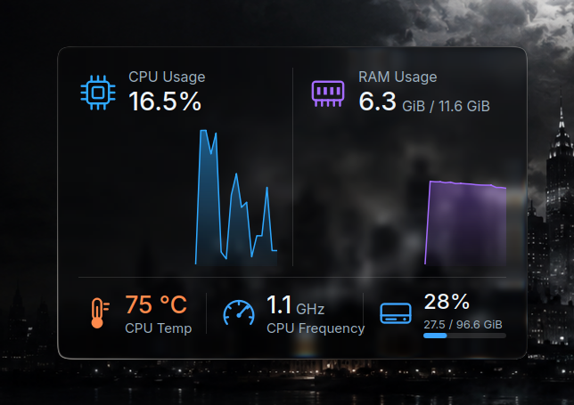

# HUD System Monitor

A frosted-glass system monitor widget for **KDE Plasma 6**. It shows CPU and RAM with live area charts, CPU temperature and frequency, and disk usage, on a card that bends and blurs whatever is behind it, in the style of macOS and futuristic HUDs.

<p align="center">
  
</p>

## Features

- **CPU and RAM** with live charts, so you see the trend and not only the number.
- **CPU temperature and frequency** in small gauges. The temperature turns red above a limit you choose.
- **Disk usage** for all disks together, or for one disk of your choice.
- **Liquid-glass card**: real refraction, a soft edge highlight and a light tint, drawn with GPU shaders. It sits well on top of any wallpaper.
- **Tunable look**: radius, thickness, tint, blur and more can be changed without touching the code (see below).
- Light on resources: it reads the same sensors as System Monitor, once per second by default.

## Install

You need Plasma 6.

**From the KDE Store:** right-click the desktop, choose *Add or Manage Widgets → Get New Widgets → Download New Plasma Widgets* and search for *HUD System Monitor*.

**From this repository:**

```bash
git clone https://github.com/aditya-kumar-k/HUD-System-Monitor.git
cd HUD-System-Monitor
kpackagetool6 -t Plasma/Applet -i package        # or -u package to update
```

Then right-click the desktop → *Add or Manage Widgets* → search for *HUD System Monitor* and drag it onto the desktop.

To remove it: `kpackagetool6 -t Plasma/Applet -r com.aadi.hudsysmon`.

To build the `.plasmoid` file yourself: `./build.sh`.

## Settings

Right-click the widget → *Configure*:

| Setting | What it does | Default |
| --- | --- | --- |
| Card title | The heading on the card | System Monitor |
| Show header | The icon, title and menu row at the top | on |
| Seconds between samples | How often the charts update | 1 |
| Samples kept for the charts | How much history the charts show | 40 |
| Disk sensor | `disk/all`, or `disk/<uuid>` for one disk | `disk/all` |
| Temperature warning | Above this (in °C) the reading turns red | 85 |

## Changing the glass look

The look is read from `~/.config/hudglassrc`, group `[Liquid]`, and re-checked every few seconds, so changes show up without restarting. For example:

```bash
kwriteconfig6 --file hudglassrc --group Liquid --key Radius 40
kwriteconfig6 --file hudglassrc --group Liquid --key TintAlpha 20
```

| Key | Meaning | Default |
| --- | --- | --- |
| `Radius` | Corner radius | 50 |
| `Roundness` | How round the corners are (×10) | 86 |
| `Thickness` | How thick the glass is | 35 |
| `IOR` | Refraction index (×100) | 170 |
| `Strength` | Refraction strength | 65 |
| `TintAlpha` | Strength of the tint (0–100) | 10 |
| `TintColor` | Tint colour | `#000000` |
| `Chroma` | Colour fringing at the edges (0–100) | 30 |
| `Specular` | Edge highlight (0–100) | 70 |
| `Blur` | Blur radius | 6 |
| `Realtime` | Keep up with an animated or video wallpaper (uses more GPU; leave off for still wallpapers) | `false` |

## Requirements

- KDE Plasma 6 (Qt 6, KDE Frameworks 6)
- `libksysguard` sensors (installed with Plasma)
- `kreadconfig6` (installed with Plasma)
- A GPU that can run Qt Quick shaders

## License

GPL-3.0-only. See [LICENSE](LICENSE).
